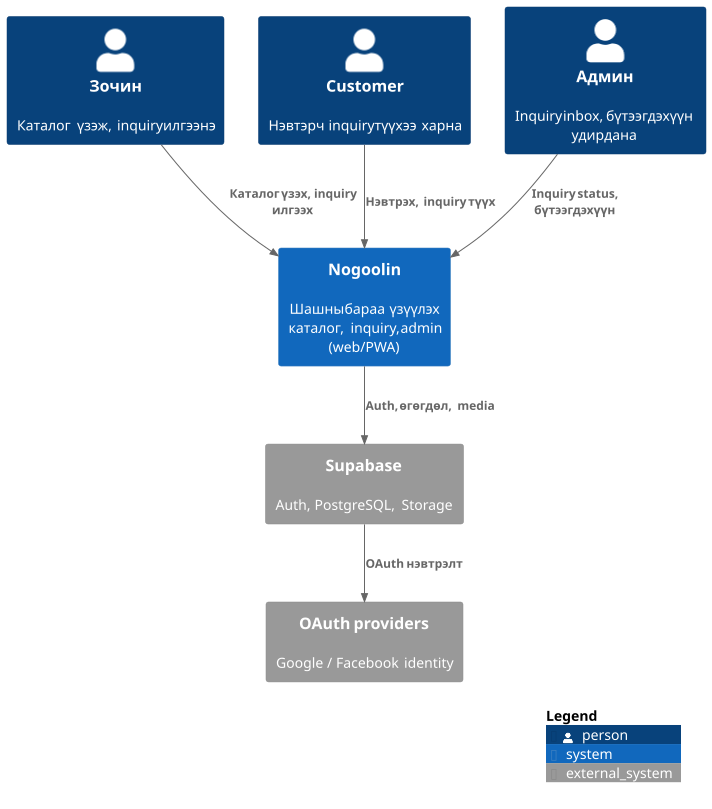
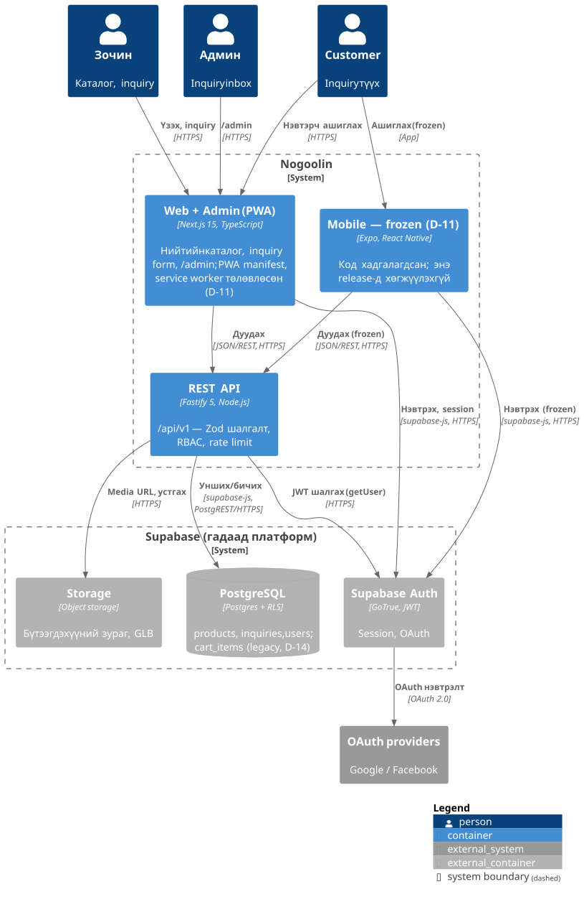
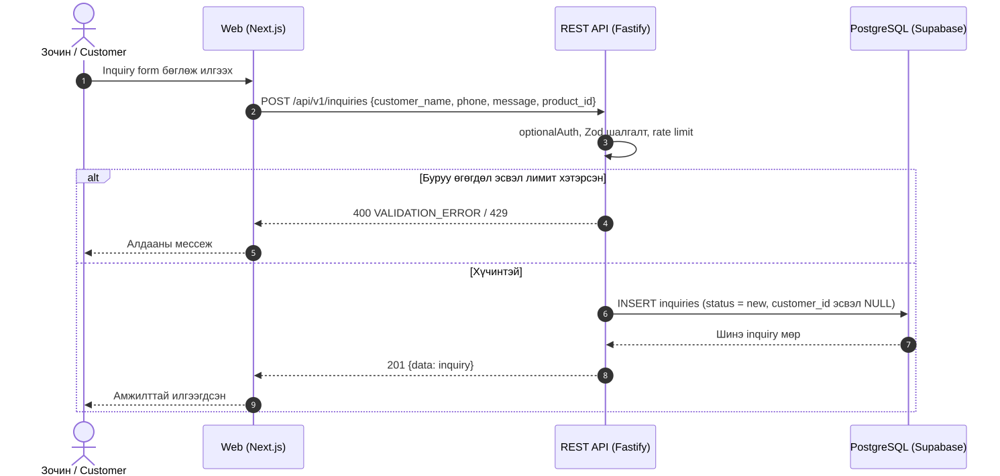
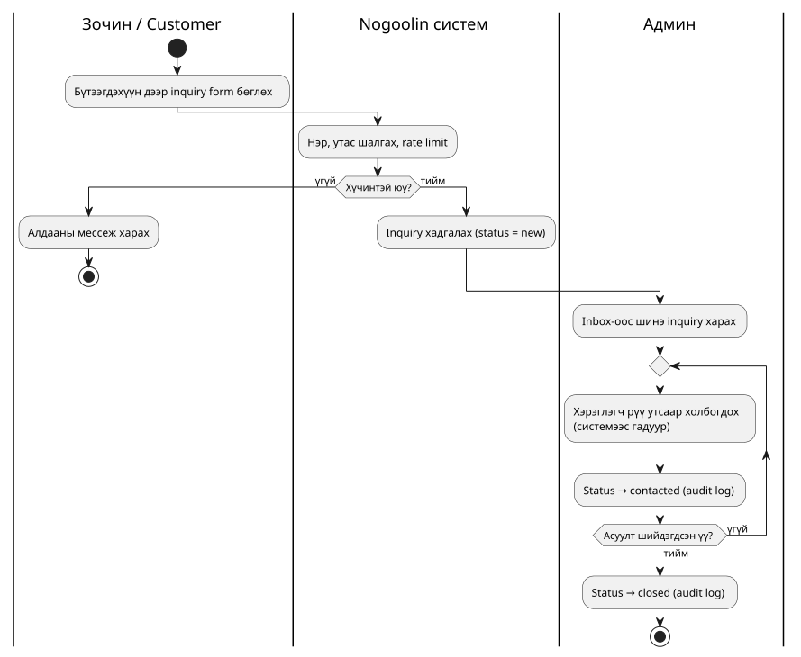

# Diagram sources

## Canonical: M8 diagram suite (ARC-07)

Nogoolin-ийн гол диаграмууд энэ хавтаст байна. Шинэ болон өөрчлөгдсөн диаграм **зөвхөн** эдгээр файлд орно.
Засварын дараа `./render.sh`-ийг дахин ажиллуулж, `rendered/*.svg`-ийг commit хийнэ.

- Эх: ICSI438 Sem10 ([`c83be9e`](https://gitlab.com/Tengis01/icsi438-nogoolin/-/tree/c83be9e/sem10/docs/diagrams)). 2026-11-24-нд
  M9-ийн хүрээнд энэ repo-д хуулсан; ICSI438 дахь хувилбар нь хичээлийн snapshot болж үлдэнэ.
- Кодтой тулгасан commit: Nogoolin `885e591` (Sem10).

| US | Файл | Агуулга |
|---|---|---|
| US-1 | [c4-context.puml](c4-context.puml) | Хэн ашигладаг, ямар гадаад системтэй холбогддог |
| US-2 | [c4-container.puml](c4-container.puml) | Web (PWA), Mobile (frozen, D-11), API, Supabase ба тэдгээрийн протокол |
| US-3 | [sequence-inquiry.mmd](sequence-inquiry.mmd) | Inquiry илгээх урсгал, 400/429 алдааны замтай |
| US-4 | [data-model.mmd](data-model.mmd) | Үндсэн 5 хүснэгт, PK/FK, холбоос |
| US-5 | [bpmn-process.puml](bpmn-process.puml) | Inquiry-г хүлээн авахаас хаах хүртэлх процесс, 3 lane |

## US-1 · C4 Context

## US-2 · C4 Container

## US-3 · Sequence: inquiry илгээх

## US-4 · Data model

## US-5 · Inquiry боловсруулах процесс

US-5 нь PlantUML activity + swimlane хэлбэртэй; бүрэн BPMN 2.0 тэмдэглэгээ биш.

## Frozen: хадгална, шинэчлэхгүй

Эдгээр нь түүхэн эх. Устгахгүй, гэхдээ засахгүй. Зөрүү гарвал canonical диаграм зөв.

- [ER diagram](../phase-0/04-er-diagram.md), [Sequence diagrams](../phase-0/05-sequence-diagrams.md) (Phase 0, ARC-05)
- [Auth](../../agent-context/diagrams/auth.md), [Inquiry submit](../../agent-context/diagrams/inquiry-submit.md), [Product browse](../../agent-context/diagrams/product-browse.md) (`agent-context/diagrams/`, ARC-05)
- [arc42](../architecture/arc42-nogoolin.md) доторх Sem4 C4 диаграм (ARC-01)

## Өөрчлөлтийн түүх

| Огноо | Өөрчлөлт |
|---|---|
| 2026-11-24 | M9: Sem10-ийн 5 эх, SVG, `render.sh`-ийг энэ хавтаст хуулж, canonical байршлыг ICSI438-аас энд шилжүүлсэн. |
| 2026-10-30 | Sem10-ийн diagram suite-ийг canonical болгож, бусдыг frozen гэж тэмдэглэсэн. |
